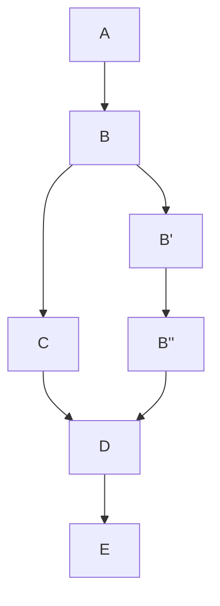
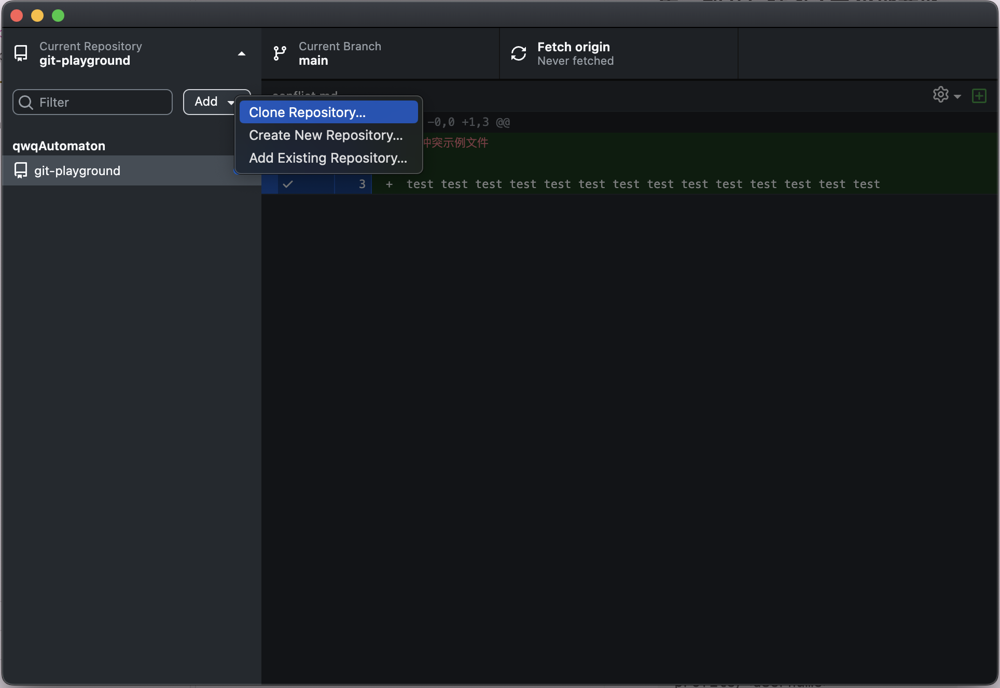
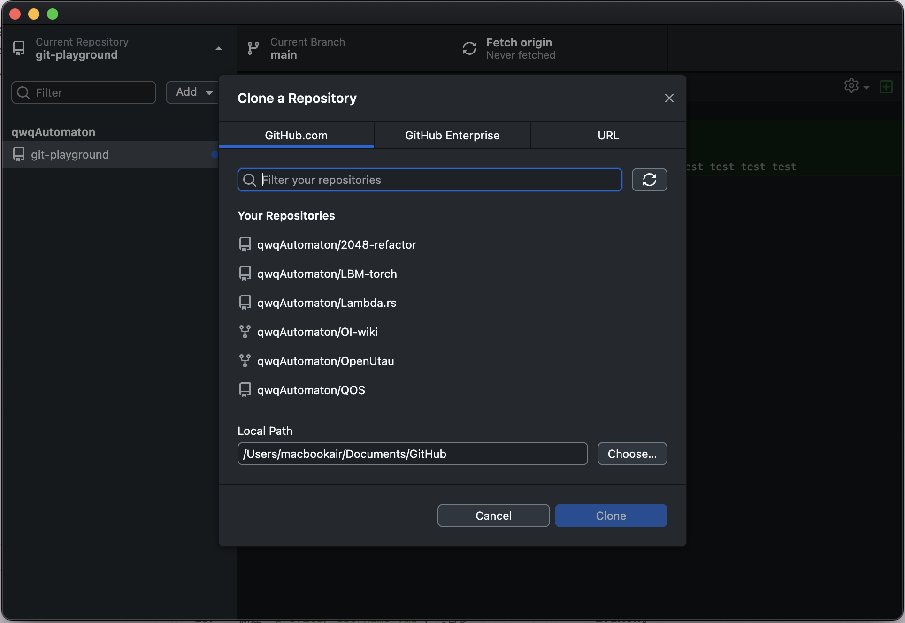
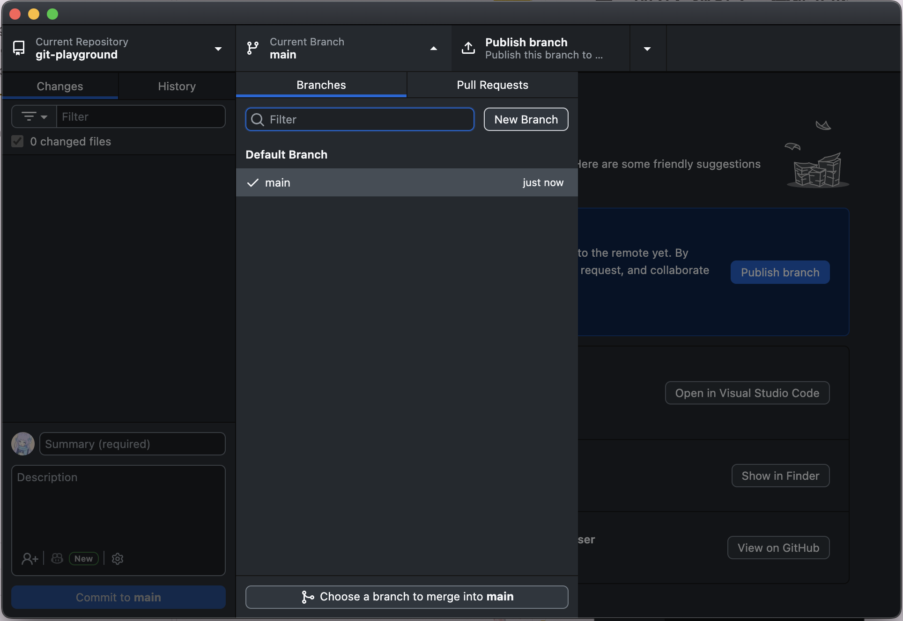
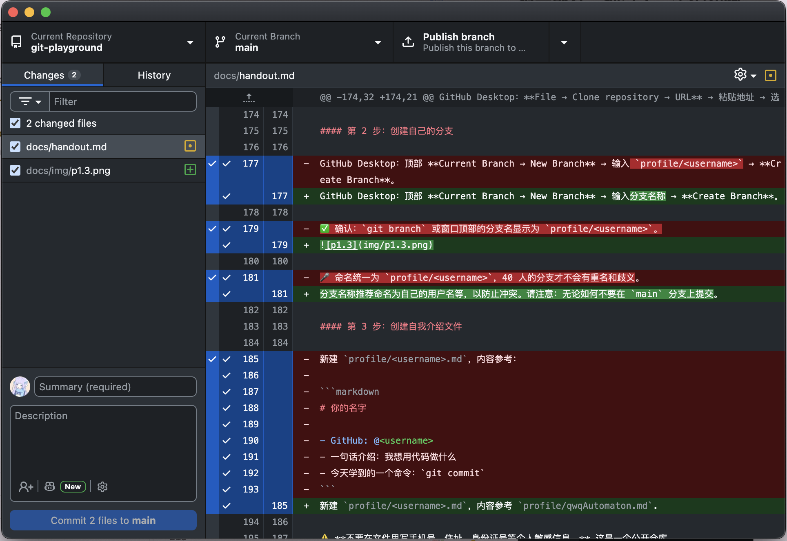
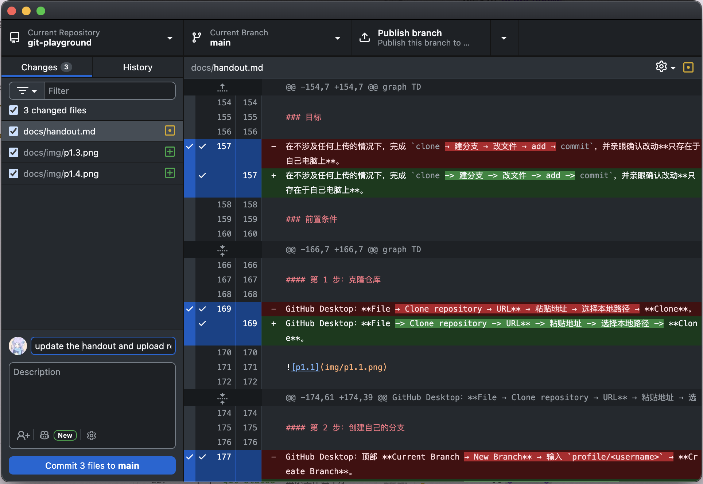
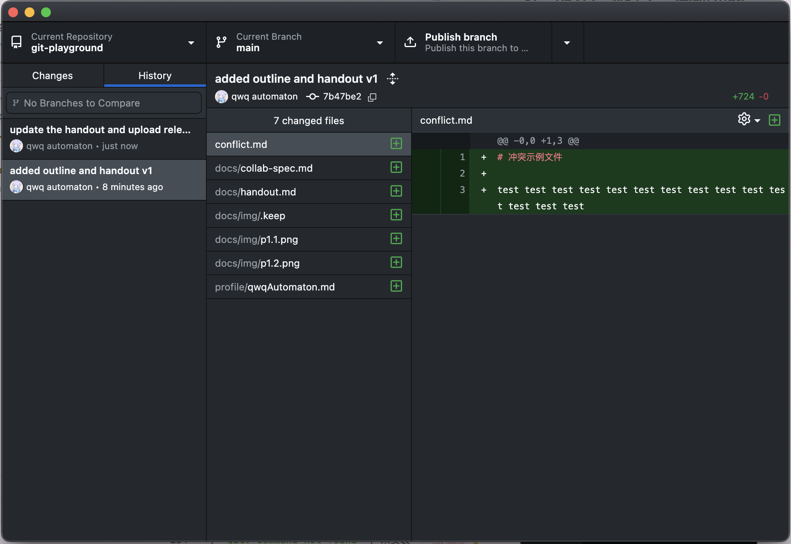
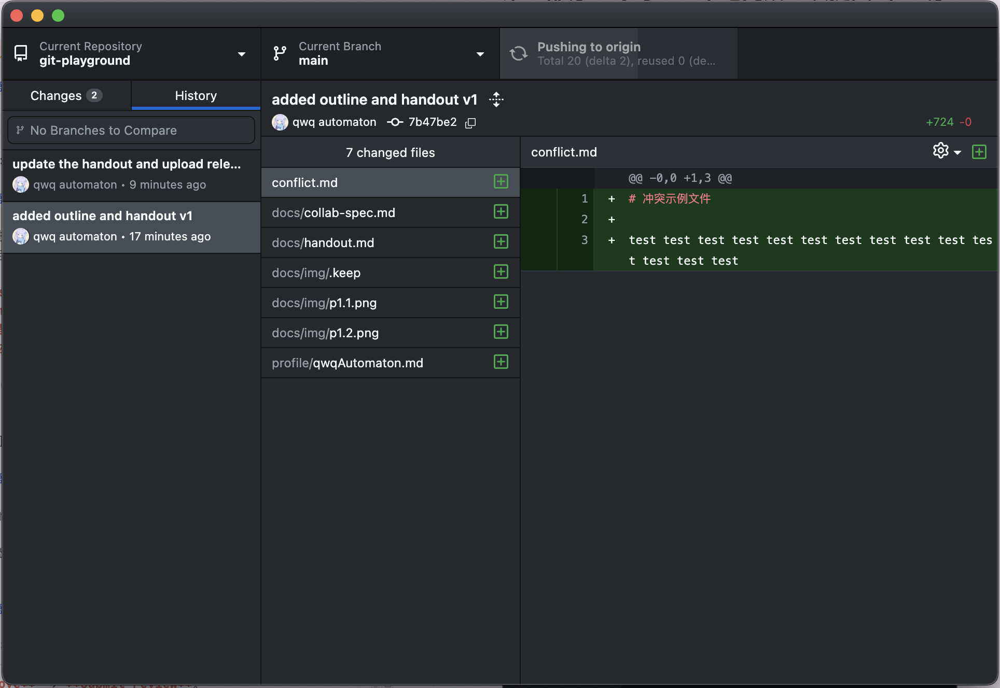
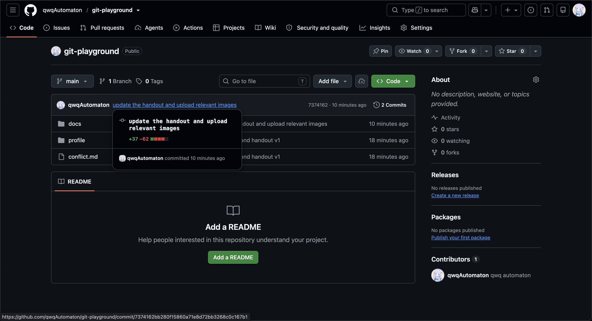

# Git & GitHub 协作入门

## 时间安排

| 部分 | 内容 | 时长 |
| --- | --- | --- |
| 第零部分 | 前置准备 | 课前 30–40 分钟 |
| 第一部分 | 为什么需要版本控制 | 10 分钟 |
| 第二部分 | Git 的核心模型 | 15 分钟 |
| 第三部分 | 练习 1：本地完成一次提交 | 30 分钟 |
| 第四部分 | 分支管理与协作流程 | 15 分钟 |
| 第五部分 | 练习 2：完成一次远程协作 | 30 分钟 |
| 第六部分 | 冲突 | 20 分钟 |
| 第七部分 | 练习 3：制造并解决冲突 | 25 分钟 |
| — | 机动 / 答疑 | 15 分钟 |

---

## 第零部分：前置（课前完成）

> 这一部分**不占用课堂时间**。课前未完成的同学，课堂上不安排现场安装排障，由助教单独处理。请善用 LLM 和搜索引擎辅助自学或询问我。

- Markdown 基础语法和阅读方式
- 注册 GitHub 账号（不建议使用真名），并将 GitHub 用户名提交给我。
- 安装 [Git](https://git-scm.com/) 和 [GitHub Desktop](https://desktop.github.com/download/).
- 接受我发出的组织邀请。
- 登录 GitHub Desktop，并配置提交身份（用户名和邮箱）。
- 自行解决 GitHub 访问的网络问题。

---

## 第一部分：为什么需要版本控制？

### 1.1 example

- `main.py`
- `main.1017.py`
- `main.1021.py`
- `main.final.py`
- `main.final.final.py`
- `main.before-modification.py`

共享文档：一坨大的

### 1.2 版本控制解决什么问题

| 你遇到的问题 | 版本控制怎么解决 |
| --- | --- |
| 想回到昨天能跑的版本 | 每次提交都是一个可回退的历史点 |
| 不知道这段代码是谁改的、为什么改 | 每次提交都记录作者、时间、说明和改动内容 |
| 用 U 盘/微信传文件，版本混乱 | 所有人从同一个远程仓库同步 |
| 改坏了想对比改了什么 | 可以查看任意两次提交之间的差异 |
| 多人同时改，互相覆盖 | 用分支隔离，用 Pull Request 合并 |

一句话：**版本控制让你可以放心地改，因为改错了能回去。**

### 1.3 三种版本控制（只讲结论）

| 类型 | 代表 | 特点 |
| --- | --- | --- |
| 本地式 | 早期 RCS | 历史只存在本机，无法协作 |
| 集中式 | SVN | 历史在服务器，断网无法提交 |
| 分布式 | **Git** | 每人本地都有完整历史，可离线提交，再与远程同步 |

### 1.4 Git 和 GitHub 的区别

| | Git | GitHub |
| --- | --- | --- |
| 是什么 | 一个版本控制**工具**，装在你自己电脑上 | 一个**网站/托管服务** |
| 负责 | 记录版本、分支、合并 | 存放远程仓库、提供 PR、Issue、Review |
| 没有对方会怎样 | 仍可本地提交，只是不能协作 | 网站没有内容可托管 |

**关键句：Git 是工具，GitHub 是平台。没有 GitHub 你也能用 Git；GitHub 上的一切协作，最终都靠 Git 完成。**

> 注意：GitHub 不是唯一的平台，GitLab、Gitee 也是同类服务。学的是 Git，不是某个网站的按钮。

---

## 第二部分：Git 的核心模型（15 分钟）

### 2.1 四个区域

这是整节课最重要的一张图。**所有操作都可以归到这张图上。**

```
工作区（Working Directory）
|
|  git add
V
暂存区（Staging Area）
|
|  git commit
V
本地仓库（Local Repository）
|
|  git push
V
远程仓库（Remote Repository）
```

| 区域 | 是什么 | 你的动作 |
| --- | --- | --- |
| 工作区 | 你正在编辑的那些文件 | 编辑、保存 |
| 暂存区 | "这次提交我要包含哪些改动"的清单 | `git add` / Desktop 里勾选文件 |
| 本地仓库 | `.git` 目录，保存全部历史 | `git commit` |
| 远程仓库 | GitHub 上那一份 | `git push` / `git pull` |

### 2.2 核心概念

**Commit（提交）**
- 一次提交 = 一份文件快照 + 提交说明 + 作者 + 时间 + 上一个提交的引用。
- 每个提交有唯一 ID（哈希，如 `a3f9c21`），可以理解为"存档点编号"。
- 提交只在**本地**产生。

**Branch（分支）**
- 分支就是一个**指向某个提交的可移动指针**。
- 默认分支通常叫 `main`。
- 创建分支几乎不占空间，也不要怕——它只是多了一个指针。

**HEAD（当前位置）**
- 表示"你现在在哪个 commit 上"。
- 迷路时第一件事就是确认 HEAD 在哪。

**commit DAG**
- Git 用 DAG 来表示提交之间的关系，每个提交都指向它的父提交，形成一个有向无环图。
- 为什么不是树：考虑 merge commit，它有两个父亲。

例子：



### 2.3 常见误解

| 误解 | 事实 |
| --- | --- |
| "commit 就是上传到 GitHub" | ❌ commit 只在本地；上传是 `push` |
| "push 会保存我的文件" | ❌ push 上传的是**提交**，未 commit 的改动不会被推送 |
| "删了分支就等于删了代码" | ❌ 删的只是指针；已合并的内容仍在 `main` |
| "GitHub 上有我的文件，本地应该也有" | ❌ 需要 `pull` 才会同步下来 |
| "改完文件就自动记录版本了" | ❌ 必须 add + commit，Git 才会记住 |

---

## 第三部分：练习 1 — 本地完成一次提交（30 分钟）

### 目标

在不涉及任何上传的情况下，完成 `clone -> 建分支 -> 改文件 -> add -> commit`，并亲眼确认改动**只存在于自己电脑上**。

### 前置条件

- 第零部分清单全部通过。
- 已拿到练习仓库地址。
- 记住自己的 GitHub 用户名（下面用 `<username>` 表示）。

### 🖥️ 操作步骤

#### 第 1 步：克隆仓库

GitHub Desktop：**File -> Clone repository -> URL** -> 粘贴地址 -> 选择本地路径 -> **Clone**。





#### 第 2 步：创建自己的分支

GitHub Desktop：顶部 **Current Branch -> New Branch** -> 输入分支名称 -> **Create Branch**。



分支名称推荐命名为自己的用户名等，以防止冲突。请注意：无论如何不要在 `main` 分支上提交。

#### 第 3 步：创建自我介绍文件

新建 `profile/<username>.md`，内容参考 `profile/qwqAutomaton.md`.

⚠️ **不要在文件里写手机号、住址、身份证号等个人敏感信息。** 这是一个公开仓库。

随便用什么编辑器都行。记事本写一个 txt 也可以。只要新建一个文件即可。

#### 第 4 步：查看自己改了什么

GitHub Desktop：左侧 changes 标签页可以显示差异。



#### 第 5 步：加入暂存区

GitHub Desktop：在 **Changes** 里**勾选**这个文件。

#### 第 6 步：提交

GitHub Desktop：右下角填 **Summary**（必填）-> 点蓝色按钮 **Commit `filecount` files to `branchname`**。

推荐 commit message 写法：**动词开头，说明这次改了什么**。

- ✅ `docs: add profile for alice`
- ✅ `fix: correct typo in conflict.md`
- ❌ `update`、`test`、`asdf`



#### 第 7 步：验证

GitHub Desktop：切到 **History** 标签。

✅ 确认：能看到自己刚写的提交说明。



### ✅ 练习 1 验收标准

- [ ] 本地已克隆仓库，`profile/` 目录存在。
- [ ] 当前分支是新建的分支，而非原分支 `main`.
- [ ] `profile/<username>.md` 已创建。
- [ ] changes 标签左侧显示工作区干净
- [ ] history 标签中能看到自己的提交
- [ ] **此刻在 GitHub 网页上打开仓库，看不到这个文件**

注意：这里所有的操作都是在本地 repo 进行的，打开 Github 远程 repo 并不会有任何改动。

---

## 第四部分：分支管理与协作流程（15 分钟）

### 4.1 本地仓库与远程仓库

- `origin` 是远程仓库的默认别名，`origin/main` 表示"远程的 main 分支"。
- 本地 `main` 和远程 `main` 可能不一致，只有 `push` / `pull` 才会同步。

| 方向 | 命令 | 作用 |
| --- | --- | --- |
| 本地 repo -> 远程 repo | `git push` | 上传自己的提交 |
| 远程 repo -> 本地 repo | `git pull` | 下载并合并远程更新 |
| 远程 repo -> 本地工作区 | `git fetch` | 下载但先不合并 |

### 4.2 为什么要用分支

🎤 提问："如果 40 个人都在 `main` 上直接提交，会发生什么？"（互相覆盖、随时可能坏掉）

三条理由：
1. **隔离**：没做完的改动不污染 `main`。
2. **保护**：`main` 始终保持可用状态。
3. **可审查**：一个分支对应一个任务，便于别人看懂你改了什么。

约定：**一个任务 = 一个分支 = 一个 PR**。

### 4.3 Pull Request 是什么

> Pull Request（PR）= 一份"请把我的分支合并进 `main`"的正式申请。

相当于需要审查的 `git pull`.

PR 页面包含了协作需要的全部信息：

- **Files changed**：你到底改了什么（逐行 diff）
- **Conversation**：讨论、提问、留评论
- **Review**：同意（Approve）或要求修改（Request changes）
- **Merge**：合并按钮
- **Checks**：自动检查结果（本次课程没有）

要区分三件事：

| 概念 | 是什么 |
| --- | --- |
| 分支 | 一条工作线 |
| PR | 合并这条工作线的申请 |
| Merge | 批准这个申请的动作 |

**开着 PR 不等于代码已合并**。合并后 PR 会变成 `Merged` 并关闭。

### 4.4 Code Review 要做的事

不要求你懂对方的领域，只要求你检查三件事：

1. **范围**：是不是只改了该改的文件？
2. **内容**：写得对不对，有没有明显错误？
3. **安全**：有没有把密码、密钥、个人隐私提交上去？

评论方式：`Comment`（提问/建议）、`Approve`（同意合并）、`Request changes`（必须先改）。

### 4.5 Issue

Issue 是任务和问题的记录单，适合课前收集任务、课后跟踪待办。

**本次练习不要求先建 Issue。** 后续团队协作中，推荐一个 Issue 对应一个分支和一个 PR；PR 描述里写 `Closes #12`，合并时会自动关闭该 Issue。

### 4.6 标准协作流程（核心）

一次完整的协作流程：


1. 更新 main：上侧按钮切换到 main 后点击 fetch origin
2. 创建分支：上侧分支按钮 -> new branch
3. 修改并提交：主要工作，左侧 Changes -> 勾选 -> 填 Summary -> Commit.
4. 推送：上侧右侧按钮 publish branch（有时可能在下拉菜单里）。
5. 确定当前开发结束后，发起 PR：
   - base：main
   - compare：你的分支
   - 按要求填写标题和描述
6. 等待审查（可以线下拷打）
7. 审查 approve 之后合并
8. 清理分支：删本地分支 + 删远程分支
9. 再次同步：上侧按钮切换到 main 后点击 fetch origin

---

## 第五部分：练习 2 — 完成一次远程协作（30 分钟）

### 目标

把练习 1 的本地提交推送到 GitHub，并完整走完一次 **PR -> Review -> Merge -> 同步 -> 清理**。

### 🖥️ 操作步骤

#### 第 1 步：推送分支

GitHub Desktop：点 **Publish Branch**。



✅ 确认：打开 GitHub 仓库页面，能看到你的分支（左侧下拉菜单切换 branch）。



#### 第 2 步：创建 Pull Request

网页：进入仓库 -> 通常会提示 **Compare & pull request**；若没有，走 **Pull requests -> New pull request**。

- **base**：`main`
- **compare**：`profile/<username>`
- **标题**：`Add profile for <username>`
- **描述**：我改了什么 / 为什么改

然后 **Create pull request**。

GitHub Desktop 里也会出现 **Preview Pull Request** 按钮，效果相同。

#### 第 3 步：自查 diff

在 PR 的 **Files changed** 里确认：**只有你自己的文件**。

⚠️ 如果出现了别人的文件或无关改动，先别合并，回到第 4 步的故障表处理。

#### 第 4 步：互相 Review（配对进行）

搭档 A 打开 B 的 PR -> **Files changed** -> 点行号旁的 `+` 留一条**具体**评论 -> **Review changes** -> 选 **Approve** -> **Submit review**。

要求：每人至少留 1 条具体评论。
- ✅ "这里 GitHub 用户名和分支名一致，没问题。"
- ❌ "LGTM"（不算有效 review）

#### 第 5 步：合并

由 PR 作者（或 reviewer）点 **Merge pull request -> Confirm merge**。

🎤 **本节课统一使用默认合并方式（Create a merge commit）**，不要在这里讲 squash / rebase，避免引入第二套历史模型。

#### 第 6 步：同步 `main`

```bash
git switch main
git pull
```

GitHub Desktop：**Current Branch -> main** -> **Pull origin**。

✅ 确认：`profile/` 里现在能看到你和搭档的文件。

#### 第 7 步：清理分支

```bash
git branch -d profile/<username>
git push origin --delete profile/<username>
```

GitHub Desktop：**Branch -> Delete…**；远程分支可在合并后的 PR 页面点 **Delete branch**。

> 合并后保留分支不是错误，但会让分支列表越来越乱。**约定：合并即删除。**

#### 第 8 步：最终验证

在 GitHub 网页上查看 `profile/` 目录，确认自己的文件已出现在 `main` 中。

### ✅ 练习 2 验收标准

| # | 标准 | 怎么查 |
| --- | --- | --- |
| 1 | 远程存在过自己的分支 | 仓库 Branches 页面 |
| 2 | PR 状态为 **Merged** | PR 页面 |
| 3 | 收到至少 1 条同伴的具体评论 | PR Conversation |
| 4 | 自己至少给同伴留了 1 条评论 | 搭档的 PR 页面 |
| 5 | 本地 `main` 已是最新（含两人文件） | `git log --oneline` |
| 6 | 本地与远程的功能分支已删除 | `git branch -a` |

🎤 **课堂控制**：第 4、5 步会形成等待队列。规则是 **"谁先完成，谁去 review 对方"**，不要按学号排队。助教负责兜底 review 落单的同学。

### ⚠️ 练习 2 常见故障

| 现象 | 原因 | 处理 |
| --- | --- | --- |
| push 报 `Updates were rejected` | 远程有你没有的提交 | 先 `git pull`，再 `git push` |
| 看不到 Compare & pull request 按钮 | 分支刚推送或页面未刷新 | 手动 **Pull requests -> New pull request** 选择分支 |
| PR 里出现大量无关文件 | 分支从过期的 `main` 创建 | 关闭 PR，从最新 `main` 重建分支后重新提交（本次就这么简单处理） |
| Merge 按钮是灰色的 | 存在冲突 / 无权限 / 有未通过的检查 | 看页面上的具体提示文字 |
| 不知道该在哪个分支 | — | `git status` 第一行，或 Desktop 顶部 |
| 合并后本地看不到搭档的文件 | 没有 `pull` | `git switch main && git pull` |
| 误删了本地分支 | — | 已合并的内容都在 `main`，重建分支即可；未合并的用 `git reflog` 找回（找助教） |
| 想撤销这次 PR 的合并 | — | 不要自己操作，找助教；本次不引入 revert |

---

## 第六部分：冲突（20 分钟）

### 6.1 冲突是怎么产生的

Git 合并时会逐行比对。**当两个人修改了同一个文件的同一区域，Git 无法判断该保留谁，就会停下来让你决定。**

产生冲突需要三个条件同时成立：

1. 两人从**同一个基础版本**出发；
2. 修改了**同一个文件**的**同一片区域**（通常是相邻几行）；
3. 先后合并到同一个分支。

🎤 **关键认知**：冲突不是错误，是 Git 在说"这里需要人来决定"。**没有冲突说明你们的改动没有重叠，是好事；有冲突也不是失败。**

### 6.2 冲突标记长什么样

打开有冲突的文件，会看到：

```
<<<<<<< HEAD
这是 main 上的内容
=======
这是你的分支上的内容
>>>>>>> profile/bob
```

| 标记 | 含义 |
| --- | --- |
| `<<<<<<< HEAD` | 冲突开始，下面是你当前所在分支（或合并目标）的内容 |
| `=======` | 分隔线 |
| `>>>>>>> profile/bob` | 冲突结束，上面是另一方（这个 PR 分支）的内容 |

### 6.3 解决冲突的四个动作

1. **打开文件**，搜索 `<<<<<<<`，找到每一处冲突。
2. **决定内容**：保留你的、保留对方的、或两边都保留/改写。
3. **删除全部标记行**（`<<<<<<<`、`=======`、`>>>>>>>`）。
4. **保存 -> add -> 提交**：

```bash
git add conflict.md
git commit
```

> 合并冲突的提交不需要 `-m`，Git 会给出默认的合并提交信息，直接保存退出即可。

✅ 判定标准：**文件里不再有任何 `<<<<<<<` / `=======` / `>>>>>>>`，内容符合你们商量的结果。**

### 6.4 在 GitHub 网页上解决冲突（课堂上用这条路径）

PR 页面出现 **"This branch has conflicts that must be resolved"** 时：

1. 点 **Resolve conflicts**。
2. 在网页编辑器里删除标记、保留想要的内容。
3. 点 **Mark as resolved**。
4. 点 **Commit merge**。
5. 回到 PR，此时 **Merge** 按钮恢复可用。

🎤 网页解决的好处是**不需要本地操作、适合大屏演示**；限制是文件很大或冲突很多时不好用，那时再回本地解决。

### 6.5 如何减少冲突

| 做法 | 为什么有效 |
| --- | --- |
| 分支小、存在时间短 | 分支活得越久，`main` 跑得越远，冲突概率越高 |
| 开工前和提交前都 `git pull` | 始终基于最新代码工作 |
| 一人一文件 / 把大文件拆小 | 改同一文件的概率下降 |
| 团队提前说清谁改哪一块 | 避免同一区域重复修改 |
| 不要顺手格式化整个文件 | 会制造大量无关的行变更，冲突面积剧增 |

### 6.6 关于 rebase

Git 还有 `rebase` 可以"整理历史"。**本次课程不使用**，原因是它会重写提交记录，一旦出错比 merge 难恢复得多。

🎤 学员问到就回答："知道有这个选项就够了，等你熟练使用 merge 之后再学。"**不要在课堂上演示 rebase**，否则第七部分的冲突练习会失控。

✅ 本部分验收（口头抽查）
- 看到三段式标记，能说出哪一段是自己的。
- 说出解决冲突后的最后一步（add + commit）。

---

## 第七部分：练习 3 — 制造并解决冲突（25 分钟）

### 组织方式（关键）

⚠️ **绝不要让 40 人同时修改同一个 `conflict.md`。** 那样产生的是一团互相干扰的烂摊子，不是可讲解的冲突。

本节课采用：

1. **全班主演示**（约 10 分钟）：由教师操作，大屏同步，全班观看 1 次完整冲突。
2. **两人一组练习**（约 15 分钟）：每组修改自己的 `conflict-group-<组号>.md`，亲手解决一次。

> 课前准备：在仓库中预置 `conflict-group-01.md` … `conflict-group-20.md`，内容与 `conflict.md` 相同。

### 7.1 教师主演示（10 分钟）

🎤 按下面的顺序做，每一步都说明"现在在哪个分支、改动在哪个区域"。

1. 展示 `conflict.md` 的初始内容（只有一行测试文字）。
2. 学生 A 的分支把**第一行**改成 A 的内容 -> push -> 开 PR。
3. 学生 B 的分支把**同一行**改成 B 的内容 -> push -> 开 PR。
4. 先合并 A 的 PR：成功，`main` 现在是 A 的内容。
5. 打开 B 的 PR：显示 **This branch has conflicts that must be resolved**。
   > 讲："B 的改动是基于旧内容写的，而 `main` 已经变了，Git 不知道留哪句。"
6. 点 **Resolve conflicts**，展示三段式标记。
7. 现场决定：保留 B 的内容，或两句话都保留——**并说明为什么这样决定**。
8. 删除标记 -> **Mark as resolved** -> **Commit merge**。
9. 回到 PR -> **Merge pull request**。
10. 打开 `main` 上的最终文件，确认没有残留标记，内容符合预期。

🎤 演示后必须问一句："**刚才哪一步是 Git 做不了的？**" 答案：第 7 步的内容取舍，只有人能决定。

### 7.2 两人一组练习（15 分钟）

每组使用 `conflict-group-<组号>.md`，步骤：

1. 两人都先 `git switch main && git pull`，拿到最新代码。
2. 各自建分支：`git switch -c conflict/<username>`。
3. 各自修改 `conflict-group-<组号>.md` 的**第一行**为不同内容，commit、push、开 PR。
4. 先合并第一个人的 PR。
5. 第二个人刷新自己的 PR，看到冲突 -> **Resolve conflicts**。
6. 小组商量保留什么内容，然后在网页里解决，提交合并。
7. 两人都 `git switch main && git pull`，确认最终文件内容一致。

### ✅ 练习 3 验收标准

- [ ] 本组的两个 PR 状态都是 **Merged**
- [ ] 最终文件中**没有任何** `<<<<<<<`、`=======`、`>>>>>>>` 残留
- [ ] 最终内容是小组成员事先商量的结果（不是随手留一句）
- [ ] 两人本地 `main` 都已 `pull` 到最新
- [ ] 能口头说出：冲突是谁造成的？（不是谁写错了，是同一区域被改了两次）

### ⚠️ 练习 3 常见故障

| 现象 | 原因 | 处理 |
| --- | --- | --- |
| 一看到冲突就慌 | 认知问题 | 提醒：这是正常流程，不是操作失误 |
| 忘了删标记就提交 | 疏漏 | 搜索 `<<<<<<<` 全删干净再提交 |
| 解决后对方的改动丢了 | 直接整段覆盖 | 用 `git diff main` 对比，或重新打开冲突重做 |
| 改完没 add 就直接合并 | 冲突未标记为已解决 | 先 `git add <file>` |
| 想放弃这次合并 | — | 本地：`git merge --abort` |
| 冲突解决完，Merge 仍是灰色 | 网页状态未刷新 | 刷新页面；检查是否仍有未解决的冲突文件 |

🎤 **收尾话术**：
>
> "冲突本身不可怕。真正的事故是把别人的改动覆盖掉，还悄悄合并了进去。所以解决冲突时，**先看清两边在说什么，再决定留什么**。"

---

## 附录 A：命令速查表

| 我想…… | 命令 |
| --- | --- |
| 下载仓库 | `git clone <url>` |
| 看当前状态 | `git status` |
| 看还没暂存的改动 | `git diff` |
| 看已暂存的改动 | `git diff --staged` |
| 新建并切换分支 | `git switch -c <branch>` |
| 切换分支 | `git switch <branch>` |
| 列出本地分支 | `git branch` |
| 列出所有分支（含远程） | `git branch -a` |
| 重命名当前分支 | `git branch -m <new-name>` |
| 暂存指定文件 | `git add <file>` |
| 提交 | `git commit -m "说明"` |
| 看历史 | `git log --oneline` |
| 推送并建立跟踪 | `git push -u origin <branch>` |
| 拉取并合并 | `git pull` |
| 删除已合并的本地分支 | `git branch -d <branch>` |
| 删除远程分支 | `git push origin --delete <branch>` |
| 撤销工作区改动 | `git restore <file>` |
| 取消暂存 | `git restore --staged <file>` |
| 放弃本次合并 | `git merge --abort` |

## 附录 B：GitHub Desktop 对照

| Git 命令 | GitHub Desktop 操作 |
| --- | --- |
| `git clone` | File -> Clone repository |
| `git switch -c` | Current Branch -> New Branch |
| `git switch` | Current Branch -> 选择分支 |
| `git status` / `git diff` | Changes 标签 |
| `git add` | Changes 中勾选文件 |
| `git commit` | Summary + Commit to `<branch>` |
| `git push` | Push origin |
| `git pull` | Fetch origin / Pull origin |
| `git log` | History 标签 |
| `git branch -d` | Branch -> Delete |

## 附录 C：故障排查总表

| 现象 | 先查什么 |
| --- | --- |
| `Repository not found` | 组织邀请是否已接受；仓库地址是否正确 |
| `Permission denied (publickey)` | 换用 HTTPS 地址，或在 Desktop 里重新登录 |
| `Please tell me who you are` | `git config --global user.name / user.email` |
| `nothing to commit` | 文件是否保存；是否已经 add |
| `Updates were rejected` | 先 `git pull` 再 `git push` |
| Merge 按钮灰色 | PR 页面的提示文字：冲突？权限？检查未通过？ |
| 文件里有 `<<<<<<<` | 冲突没解决完，不能提交 |
| 本地看不到别人的改动 | `git switch main && git pull` |
| 不确定自己在哪 | `git status` 第一行 / Desktop 顶部 |

## 附录 D：教师检查清单

**课前**

- [ ] 仓库已创建，`main` 可 clone，`profile/` 与 `conflict.md` 已就位
- [ ] 已预置 `conflict-group-01..20.md`
- [ ] 全员已加入组织且具备 Write 权限
- [ ] 已完成两人配对，并公布"谁 review 谁"
- [ ] 完成率统计，未完成者已安排补装
- [ ] 演示用仓库、浏览器标签页、大屏已就绪

**课中**

- [ ] 第零部分遗留问题只由助教单独处理
- [ ] 每部分结束做一次口头验收，不通过不进入下一部分
- [ ] 练习 1 结束前确认"网页上看不到文件"这一现象
- [ ] 练习 2 用"先完成者先 review"避免排队
- [ ] 练习 3 只做一次全班演示，其余分组进行
- [ ] 预留 15 分钟机动时间

**网络/环境故障预案**

- 全员无法访问 GitHub：先做练习 1 的本地部分（clone 需要网络，可提前准备一份本地副本或离线 bundle），把 PR 环节改为演示。
- 部分人推送失败：让这些人改为本地演示分支与提交，PR 环节由搭档代为操作，课后补做。
- 时间不足：**砍第六部分讲授时长，不砍练习 2 和练习 3**。

## 附录 E：课后练习

1. 在你的 `profile/<username>.md` 中新增一行"我最想用 Git 做的三件事"，走完整的 9 步流程再提交一次 PR。
2. 找一个自己的小项目，初始化 Git（`git init`），完成 3 次有意义的提交。
3. 阅读自己已合并的 PR，尝试用 `Request changes` 给同学留一条改进建议。
4. 提前预习：`git revert`（安全地撤销一次已合并的提交）。
