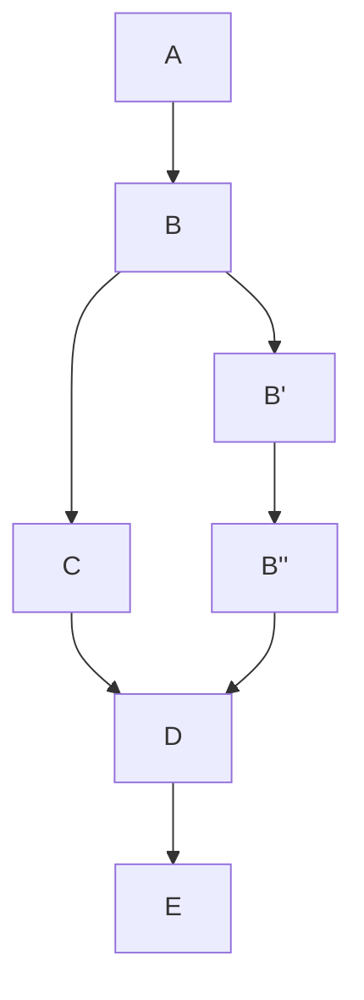
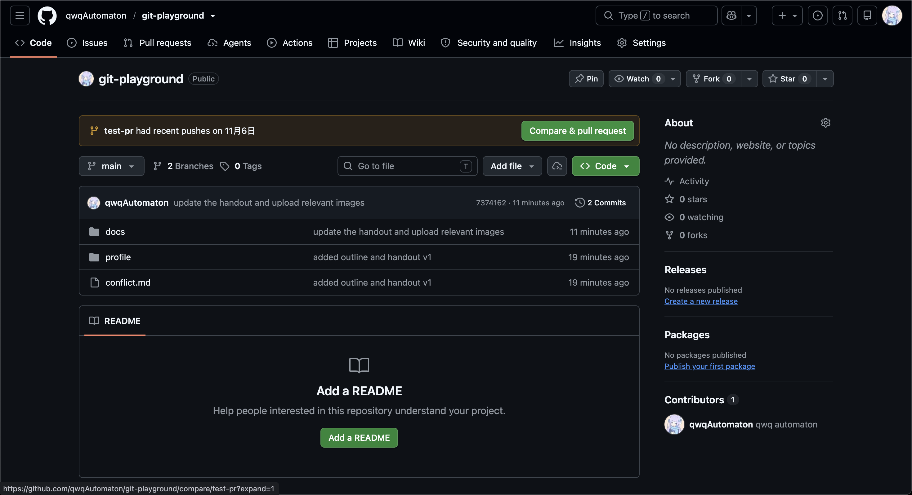
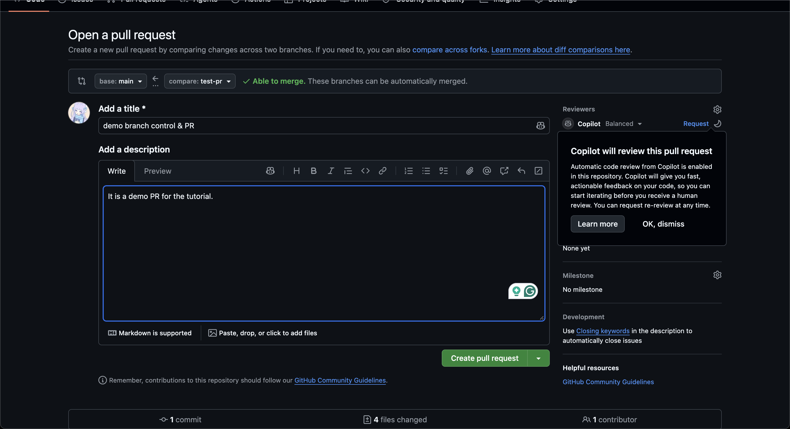
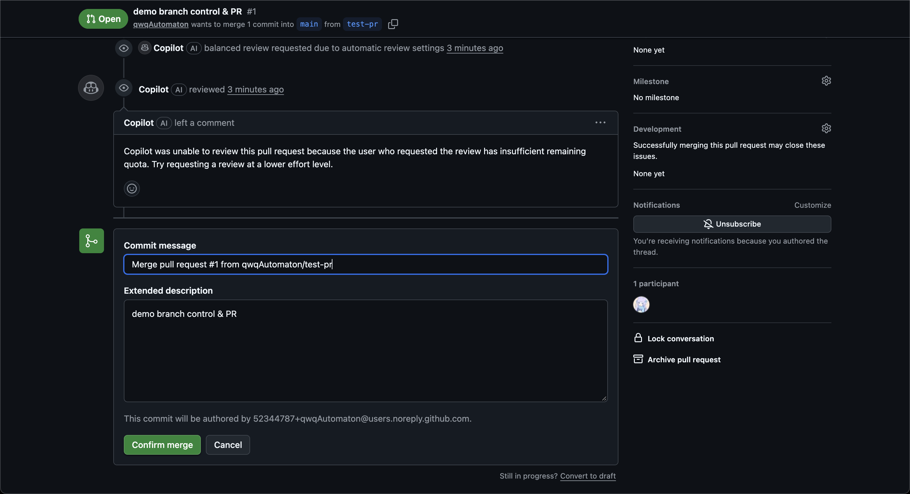
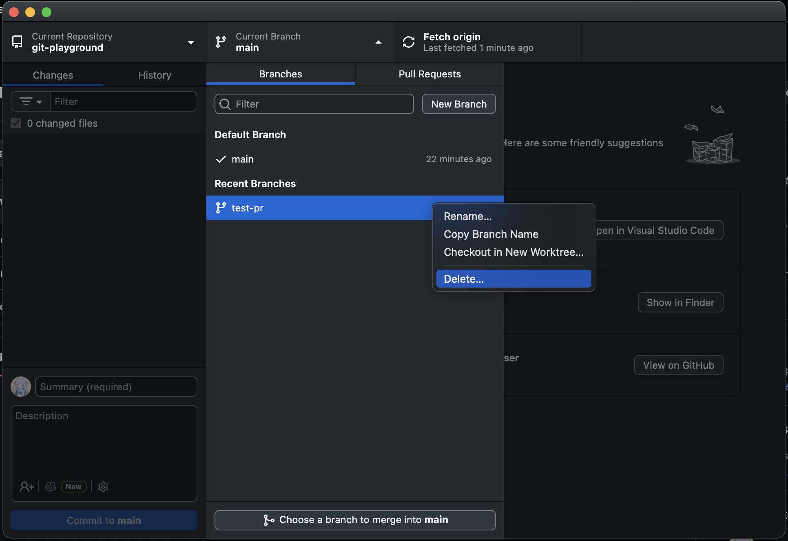
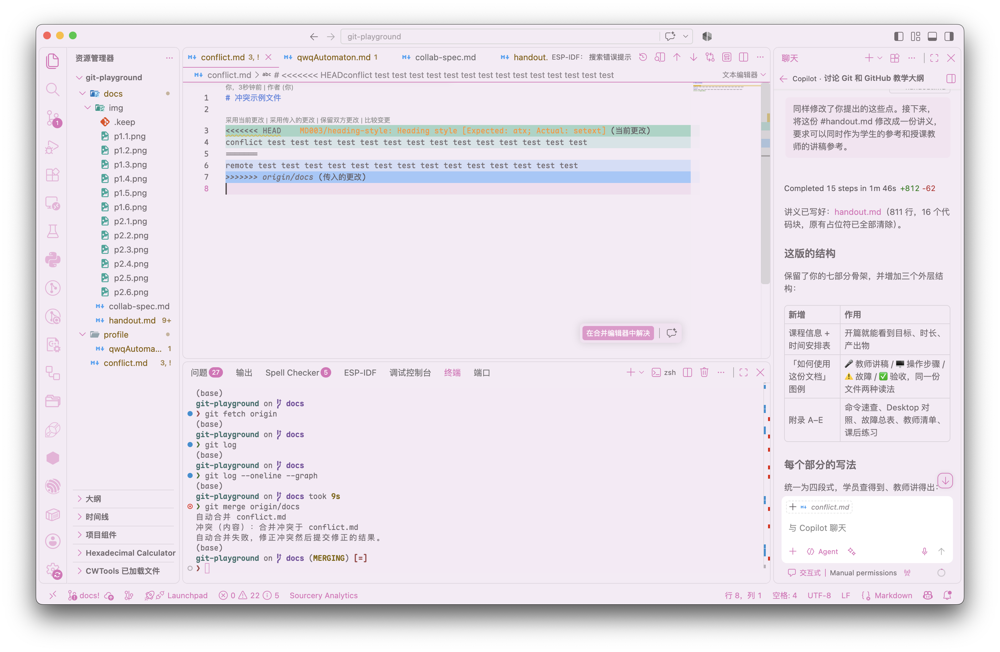
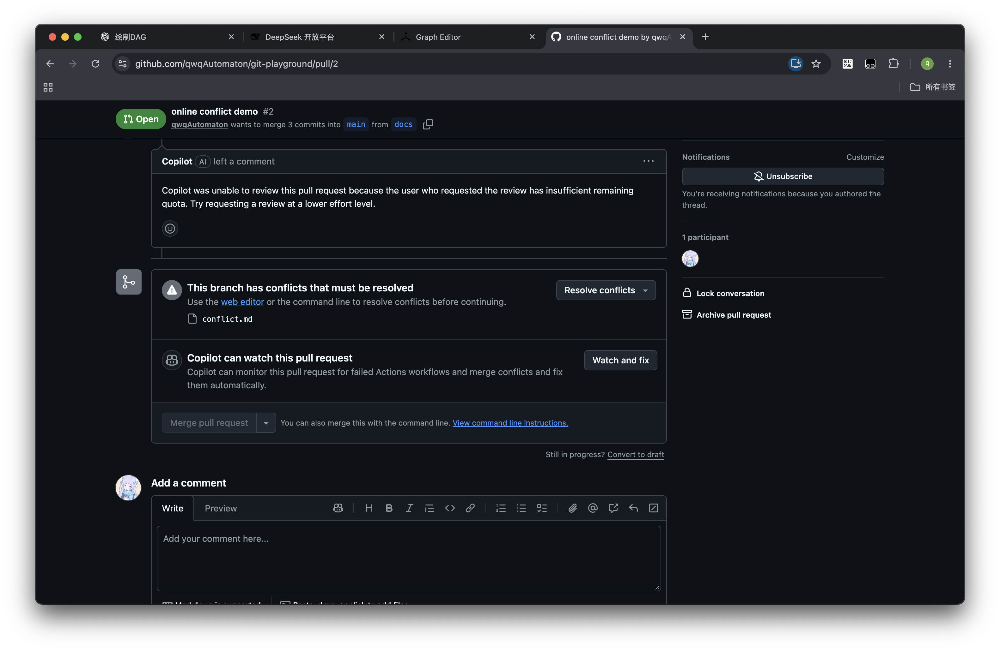
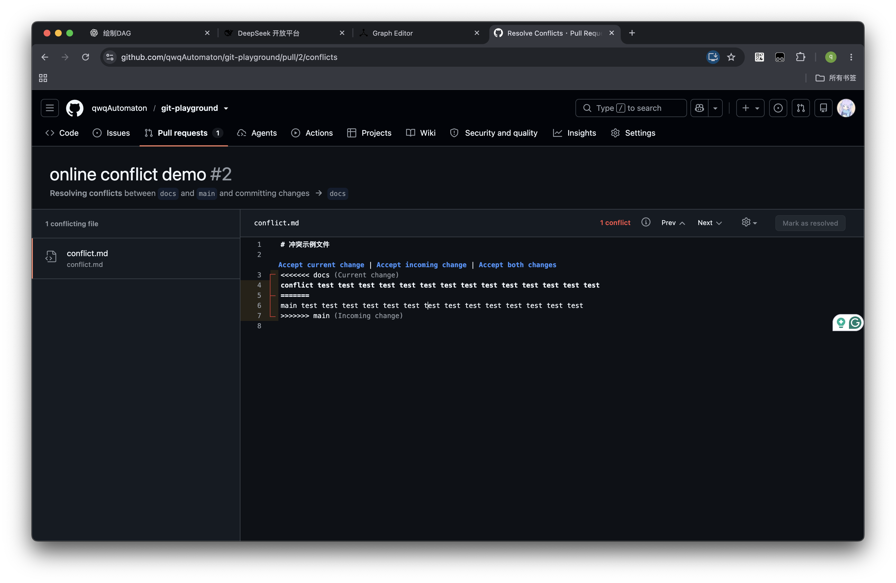

# Git & GitHub 协作入门

## 时间安排

| 部分 | 内容 | 时长 |
| --- | --- | --- |
| 第零部分 | 前置准备 | 课前 30–40 分钟 |
| 第一部分 | 为什么需要版本控制 | 10 分钟 |
| 第二部分 | Git 的核心模型 | 15 分钟 |
| 第三部分 | 练习 1：本地完成一次提交 | 30 分钟 |
| 第四部分 | 分支管理与协作流程 | 15 分钟 |
| 第五部分 | 练习 2：完成一次远程协作 | 30 分钟 |
| 第六部分 | 冲突 | 20 分钟 |
| 第七部分 | 练习 3：制造并解决冲突 | 25 分钟 |
| — | 机动 / 答疑 | 15 分钟 |

---

## 第零部分：前置（课前完成）

> 这一部分**不占用课堂时间**。课前未完成的同学，课堂上不安排现场安装排障，由助教单独处理。请善用 LLM 和搜索引擎辅助自学或询问我。

- Markdown 基础语法和阅读方式
- 注册 GitHub 账号（不建议使用真名），并将 GitHub 用户名提交给我。
- 安装 [Git](https://git-scm.com/) 和 [GitHub Desktop](https://desktop.github.com/download/).
- 接受我发出的组织邀请。
- 登录 GitHub Desktop，并配置提交身份（用户名和邮箱）。
- 自行解决 GitHub 访问的网络问题。

---

## 第一部分：为什么需要版本控制？

### 1.1 example

- `main.py`
- `main.1017.py`
- `main.1021.py`
- `main.final.py`
- `main.final.final.py`
- `main.before-modification.py`

共享文档：一坨大的

### 1.2 版本控制解决什么问题

| 你遇到的问题 | 版本控制怎么解决 |
| --- | --- |
| 想回到昨天能跑的版本 | 每次提交都是一个可回退的历史点 |
| 不知道这段代码是谁改的、为什么改 | 每次提交都记录作者、时间、说明和改动内容 |
| 用 U 盘/微信传文件，版本混乱 | 所有人从同一个远程仓库同步 |
| 改坏了想对比改了什么 | 可以查看任意两次提交之间的差异 |
| 多人同时改，互相覆盖 | 用分支隔离，用 Pull Request 合并 |

一句话：**版本控制让你可以放心地改，因为改错了能回去。**

### 1.3 三种版本控制（只讲结论）

| 类型 | 代表 | 特点 |
| --- | --- | --- |
| 本地式 | 早期 RCS | 历史只存在本机，无法协作 |
| 集中式 | SVN | 历史在服务器，断网无法提交 |
| 分布式 | **Git** | 每人本地都有完整历史，可离线提交，再与远程同步 |

### 1.4 Git 和 GitHub 的区别

| | Git | GitHub |
| --- | --- | --- |
| 是什么 | 一个版本控制**工具**，装在你自己电脑上 | 一个**网站/托管服务** |
| 负责 | 记录版本、分支、合并 | 存放远程仓库、提供 PR、Issue、Review |
| 没有对方会怎样 | 仍可本地提交，只是不能协作 | 网站没有内容可托管 |

**关键句：Git 是工具，GitHub 是平台。没有 GitHub 你也能用 Git；GitHub 上的一切协作，最终都靠 Git 完成。**

> 注意：GitHub 不是唯一的平台，GitLab、Gitee 也是同类服务。学的是 Git，不是某个网站的按钮。

---

## 第二部分：Git 的核心模型（15 分钟）

### 2.1 四个区域

这是整节课最重要的一张图。**所有操作都可以归到这张图上。**

```
工作区（Working Directory）
|
|  git add
V
暂存区（Staging Area）
|
|  git commit
V
本地仓库（Local Repository）
|
|  git push
V
远程仓库（Remote Repository）
```

| 区域 | 是什么 | 你的动作 |
| --- | --- | --- |
| 工作区 | 你正在编辑的那些文件 | 编辑、保存 |
| 暂存区 | "这次提交我要包含哪些改动"的清单 | `git add` / Desktop 里勾选文件 |
| 本地仓库 | `.git` 目录，保存全部历史 | `git commit` |
| 远程仓库 | GitHub 上那一份 | `git push` / `git pull` |

### 2.2 核心概念

**Commit（提交）**
- 一次提交 = 一份文件快照 + 提交说明 + 作者 + 时间 + 上一个提交的引用。
- 每个提交有唯一 ID（哈希，如 `a3f9c21`），可以理解为"存档点编号"。
- 提交只在**本地**产生。

**Branch（分支）**
- 分支就是一个**指向某个提交的可移动指针**。
- 默认分支通常叫 `main`。
- 创建分支几乎不占空间，也不要怕——它只是多了一个指针。

**HEAD（当前位置）**
- 表示"你现在在哪个 commit 上"。
- 迷路时第一件事就是确认 HEAD 在哪。

**commit DAG**
- Git 用 DAG 来表示提交之间的关系，每个提交都指向它的父提交，形成一个有向无环图。
- 为什么不是树：考虑 merge commit，它有两个父亲。

例子：



### 2.3 常见误解

| 误解 | 事实 |
| --- | --- |
| "commit 就是上传到 GitHub" | ❌ commit 只在本地；上传是 `push` |
| "push 会保存我的文件" | ❌ push 上传的是**提交**，未 commit 的改动不会被推送 |
| "删了分支就等于删了代码" | ❌ 删的只是指针；已合并的内容仍在 `main` |
| "GitHub 上有我的文件，本地应该也有" | ❌ 需要 `pull` 才会同步下来 |
| "改完文件就自动记录版本了" | ❌ 必须 add + commit，Git 才会记住 |

---

## 第三部分：练习 1 — 本地完成一次提交（30 分钟）

### 目标

在不涉及任何上传的情况下，完成 `clone -> 建分支 -> 改文件 -> add -> commit`，并亲眼确认改动**只存在于自己电脑上**。

### 前置条件

- 第零部分清单全部通过。
- 已拿到练习仓库地址。
- 记住自己的 GitHub 用户名（下面用 `<username>` 表示）。

### 🖥️ 操作步骤

#### 第 1 步：克隆仓库

GitHub Desktop：**File -> Clone repository -> URL** -> 粘贴地址 -> 选择本地路径 -> **Clone**。


#### 第 2 步：创建自己的分支

GitHub Desktop：顶部 **Current Branch -> New Branch** -> 输入分支名称 -> **Create Branch**。


分支名称推荐命名为自己的用户名等，以防止冲突。请注意：无论如何不要在 `main` 分支上提交。

#### 第 3 步：创建自我介绍文件

新建 `profile/<username>.md`，内容参考 `profile/qwqAutomaton.md`.

⚠️ **不要在文件里写手机号、住址、身份证号等个人敏感信息。** 这是一个公开仓库。

随便用什么编辑器都行。记事本写一个 txt 也可以。只要新建一个文件即可。

#### 第 4 步：查看自己改了什么

GitHub Desktop：左侧 changes 标签页可以显示差异。


#### 第 5 步：加入暂存区

GitHub Desktop：在 **Changes** 里**勾选**这个文件。

#### 第 6 步：提交

GitHub Desktop：右下角填 **Summary**（必填）-> 点蓝色按钮 **Commit `filecount` files to `branchname`**。

推荐 commit message 写法：**动词开头，说明这次改了什么**。

- ✅ `docs: add profile for alice`
- ✅ `fix: correct typo in conflict.md`
- ❌ `update`、`test`、`asdf`


#### 第 7 步：验证

GitHub Desktop：切到 **History** 标签。

✅ 确认：能看到自己刚写的提交说明。


### ✅ 练习 1 验收标准

- [ ] 本地已克隆仓库，`profile/` 目录存在。
- [ ] 当前分支是新建的分支，而非原分支 `main`.
- [ ] `profile/<username>.md` 已创建。
- [ ] changes 标签左侧显示工作区干净
- [ ] history 标签中能看到自己的提交
- [ ] **此刻在 GitHub 网页上打开仓库，看不到这个文件**

注意：这里所有的操作都是在本地 repo 进行的，打开 Github 远程 repo 并不会有任何改动。

---

## 第四部分：分支管理与协作流程（15 分钟）

### 4.1 本地仓库与远程仓库

- `origin` 是远程仓库的默认别名，`origin/main` 表示"远程的 main 分支"。
- 本地 `main` 和远程 `main` 可能不一致，只有 `push` / `pull` 才会同步。

| 方向 | 命令 | 作用 |
| --- | --- | --- |
| 本地 repo -> 远程 repo | `git push` | 上传自己的提交 |
| 远程 repo -> 本地 repo | `git pull` | 下载并合并远程更新 |
| 远程 repo -> 本地工作区 | `git fetch` | 下载但先不合并 |

### 4.2 为什么要用分支

🎤 提问："如果 40 个人都在 `main` 上直接提交，会发生什么？"（互相覆盖、随时可能坏掉）

三条理由：
1. **隔离**：没做完的改动不污染 `main`。
2. **保护**：`main` 始终保持可用状态。
3. **可审查**：一个分支对应一个任务，便于别人看懂你改了什么。

约定：**一个任务 = 一个分支 = 一个 PR**。

### 4.3 Pull Request 是什么

> Pull Request（PR）= 一份"请把我的分支合并进 `main`"的正式申请。

相当于需要审查的 `git pull`.

PR 页面包含了协作需要的全部信息：

- **Files changed**：你到底改了什么（逐行 diff）
- **Conversation**：讨论、提问、留评论
- **Review**：同意（Approve）或要求修改（Request changes）
- **Merge**：合并按钮
- **Checks**：自动检查结果（本次课程没有）

要区分三件事：

| 概念 | 是什么 |
| --- | --- |
| 分支 | 一条工作线 |
| PR | 合并这条工作线的申请 |
| Merge | 批准这个申请的动作 |

**开着 PR 不等于代码已合并**。合并后 PR 会变成 `Merged` 并关闭。

### 4.4 Code Review 要做的事

不要求你懂对方的领域，只要求你检查三件事：

1. **范围**：是不是只改了该改的文件？
2. **内容**：写得对不对，有没有明显错误？
3. **安全**：有没有把密码、密钥、个人隐私提交上去？

评论方式：`Comment`（提问/建议）、`Approve`（同意合并）、`Request changes`（必须先改）。

### 4.5 Issue

Issue 是任务和问题的记录单，适合课前收集任务、课后跟踪待办。

**本次练习不要求先建 Issue。** 后续团队协作中，推荐一个 Issue 对应一个分支和一个 PR；PR 描述里写 `Closes #12`，合并时会自动关闭该 Issue。

### 4.6 标准协作流程（核心）

一次完整的协作流程：


1. 更新 main：上侧按钮切换到 main 后点击 fetch origin
2. 创建分支：上侧分支按钮 -> new branch
3. 修改并提交：主要工作，左侧 Changes -> 勾选 -> 填 Summary -> Commit.
4. 推送：上侧右侧按钮 publish branch（有时可能在下拉菜单里）。
5. 确定当前开发结束后，发起 PR：
   - base：main
   - compare：你的分支
   - 按要求填写标题和描述
6. 等待审查（可以线下拷打）
7. 审查 approve 之后合并
8. 清理分支：删本地分支 + 删远程分支
9. 再次同步：上侧按钮切换到 main 后点击 fetch origin

---

## 第五部分：练习 2 — 完成一次远程协作（30 分钟）

### 目标

把练习 1 的本地提交推送到 GitHub，并完整走完一次 **PR -> Review -> Merge -> 同步 -> 清理**。

### 🖥️ 操作步骤

#### 第 1 步：推送分支

GitHub Desktop：点 **Publish Branch**。


✅ 确认：打开 GitHub 仓库页面，能看到你的分支（左侧下拉菜单切换 branch）。


#### 第 2 步：创建 Pull Request

网页：进入仓库 -> 通常会提示 **Compare & pull request**；若没有，走 **Pull requests -> New pull request**。



按需填写标题和描述、目标 branch、来源 branch 等信息。



然后 **Create pull request**。

GitHub Desktop 里也会出现 **Preview Pull Request** 按钮，效果相同。

#### 第 3 步：等待/给予 review

找一个还没合并的 PR，点击 Files Changed 标签页进行 review，并发表评论。如果可行，点击 Approve；否则 Request Changes.

#### 第 4 步：合并

由 PR 作者（或 reviewer）点 **Merge pull request -> Confirm merge**。

由于合并的原理是创建一个新的 merge commit，你需要填写 commit message（此时先采用默认即可）。



#### 第 5 步：同步 `main`

由于 PR 合并后，远程的 `main` 已经更新了，本地的 `main` 还没有同步。我们需要同步本地的 `main`.

GitHub Desktop：上侧按钮切换到 main，然后点击 fetch origin.

✅ 确认：`profile/` 里现在能看到你和搭档的文件。

#### 第 6 步：清理分支

GitHub Desktop：上侧 branch 菜单找到自己的 branch，右键 delete；远程分支可在合并后的 PR 页面点 **Delete branch** 或由 Github Desktop 自动删除。

不删理论上也没事，但是会越来越乱。所以推荐合并后就删掉.



### ✅ 练习 2 验收标准

| # | 标准 | 怎么查 |
| --- | --- | --- |
| 1 | 远程存在过自己的分支 | 仓库 Branches 页面 |
| 2 | PR 状态为 **Merged** | PR 页面 |
| 3 | 收到至少 1 条同伴的具体评论 | PR Conversation |
| 4 | 自己至少给同伴留了 1 条评论 | 搭档的 PR 页面 |
| 5 | 本地 `main` 已是最新（含两人文件） | `git log --oneline` |
| 6 | 本地与远程的功能分支已删除 | `git branch -a` |

---

## 第六部分：冲突（20 分钟）

### 6.1 冲突是怎么产生的

Git 合并时会逐行比对。**当两个人修改了同一个文件的同一区域，Git 无法判断该保留谁，就会停下来让你决定。**

产生冲突需要三个条件同时成立：

1. 两人从**同一个基础版本**出发；
2. 修改了**同一个文件**的**同一片区域**（通常是相邻几行）；
3. 先后合并到同一个分支。

### 6.2 冲突标记长什么样

打开有冲突的文件，会看到：



| 标记 | 含义 |
| --- | --- |
| `<<<<<<< HEAD` | 冲突开始，下面是你当前所在分支（或合并目标）的内容 |
| `=======` | 分隔线 |
| `>>>>>>> origin/docs` | 冲突结束，上面是另一方（这个 PR 分支）的内容 |

### 6.3 解决冲突的四个动作

1. **打开文件**，搜索 `<<<<<<<`，找到每一处冲突。
2. **决定内容**：保留你的、保留对方的、或两边都保留/改写。
3. **删除全部标记行**（`<<<<<<<`、`=======`、`>>>>>>>`）。
4. **保存 -> add -> 提交**.

✅ 判定标准：**文件里不再有任何 `<<<<<<<` / `=======` / `>>>>>>>`，内容符合你们商量的结果。**

### 6.4 在 GitHub 网页上解决冲突

PR 页面出现 **"This branch has conflicts that must be resolved"** 时：

1. 点 **Resolve conflicts**。
2. 在网页编辑器里删除标记、保留想要的内容。
3. 点 **Mark as resolved**。
4. 点 **Commit merge**。
5. 回到 PR，此时 **Merge** 按钮恢复可用。





### 6.5 如何减少冲突

| 做法 | 为什么有效 |
| --- | --- |
| 分支小、存在时间短 | 分支活得越久，`main` 跑得越远，冲突概率越高 |
| 开工前和提交前都 `git pull` | 始终基于最新代码工作 |
| 一人一文件 / 把大文件拆小 | 改同一文件的概率下降 |
| 团队提前说清谁改哪一块 | 避免同一区域重复修改 |
| 不要顺手格式化整个文件 | 会制造大量无关的行变更，冲突面积剧增 |

> "冲突本身不可怕。真正的事故是把别人的改动覆盖掉，还悄悄合并了进去。所以解决冲突时，**先看清两边在说什么，再决定留什么**。"